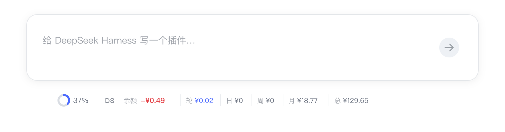
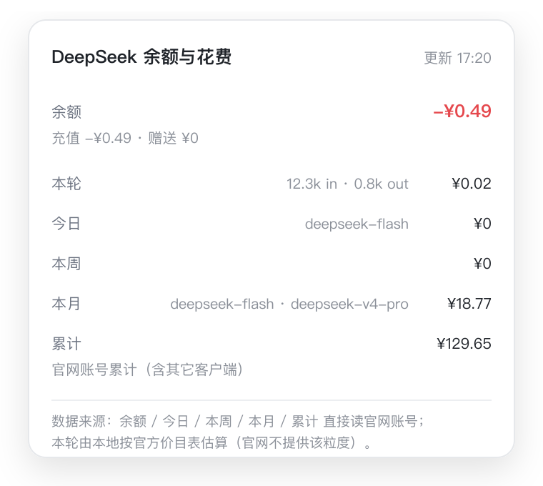

# dsh-deepseek-cost

[简体中文](README.md) | English

A **DeepSeek Harness** plugin that keeps your **DeepSeek account balance** and your
**current turn / today / this week / this month / all-time** spend visible under the
conversation composer. Hover for details, click to refresh.

The dock reuses the same composer slot and visual language as
[`dsh-go-quota`](https://github.com/skyrocks/dsh-go-quota).

<p align="center">
  
</p>

<p align="center">
  
</p>

> Illustrations only; the real dock follows the DSH light/dark theme.

```text
DS  -¥0.49 │ 轮 ¥0.02 │ 日 ¥0 │ 周 ¥0 │ 月 ¥18.77 │ 总 ¥129.65
```

> **Only shown for official models.** The dock appears when the session's provider is
> `deepseek-official` / `deepseek-account`, and stays hidden for subscription
> routes such as `opencode-go`, which never consume the DeepSeek balance.

---

## Where the numbers come from

| Value | Source |
| --- | --- |
| Balance | **Platform account** — `GET /api/v0/users/get_user_summary`, topped-up + granted wallets (overdraft is shown negative) |
| All-time | Same endpoint's `total_costs`: account-wide cumulative spend |
| Today / week / month | **Platform account** — `GET /api/v0/usage/by_api_key/cost`, summed over daily buckets |
| Current turn | **Local estimate** — the session's latest turn usage × the official price table (the Platform has no per-turn figure) |

- Day boundaries use the host timezone; weeks start on Monday.
- The current turn is the only computed value and the only one without a one-to-one
  counterpart on the Platform.
- Signed out? The balance falls back to the DeepSeek API key route
  (`/user/balance`), and today/week/month/all-time show `—` instead of a guess.

## Official price table (CNY per 1M tokens)

Used only for the current-turn estimate:

| Model | Cache hit | Cache miss | Output |
| --- | --- | --- | --- |
| `deepseek-flash` (incl. legacy `deepseek-v4-flash*`) | peak 0.04 / off-peak 0.02 | peak 2 / off-peak 1 | peak 8 / off-peak 4 |
| `deepseek-v4-pro` | peak 0.30 / off-peak 0.15 | peak 9 / off-peak 4.5 | peak 27 / off-peak 13.5 |

Peak = Beijing time, Monday–Friday 09:00–12:00 and 14:00–18:00 (public holidays cannot be
detected locally and are billed as peak).

## Install

### Desktop app (recommended)

1. Settings → Plugins → Add plugin, paste the absolute path of this directory:
   ```
   /Users/you/dsh-deepseek-cost
   ```
2. Quit DSH completely and reopen it (host plugins load at startup).
3. Pick an official DeepSeek model; the dock appears under the composer.

### Local development (`link:`)

Add the dependency and bundle to the profile's `package.json`, then restart:

```jsonc
{
  "dsh": { "profile": { "bundles": ["@deepseek-ai/dsh-base", "@deepseek-ai/dsh-web-app", "dsh-deepseek-cost"] } },
  "dependencies": { "dsh-deepseek-cost": "link:/Users/you/dsh-deepseek-cost" }
}
```

and point `node_modules/dsh-deepseek-cost` at this directory (`pnpm install` or a manual
symlink). The plugin row (`id: deepseek-cost`) is inserted by `cordis.patch.yml`.

## Configuration

Override by id in the profile's `cordis.patch.yml`:

```yaml
- id: deepseek-cost
  config:
    cacheMs: 60000
    prices:
      deepseek-flash: { input: 2, cacheRead: 0.04, output: 8 }
```

| Field | Default | Meaning |
| --- | --- | --- |
| `refreshMs` | `30000` | Client poll interval (ms) |
| `cacheMs` | `60000` | Platform data cache (ms); a refresh costs at most 2 requests |
| `prices` | Official CNY table | **Current-turn only**: per 1M tokens, `{peak, offPeak}` or a single tier |
| `currency` | `CNY` | Display currency when Platform data is unavailable |
| `cnyToUsd` | `0.139` | Rate used when displaying USD (current turn only) |
| `timeoutMs` | `15000` | Per-request timeout |
| `clientVersion` | `1.0.0` | `x-client-version` sent to the Platform |

## FAQ

**Nothing shows up?**
The session is not using an official route (`deepseek-official` / `deepseek-account`).

**Does the balance match the website?**
Yes — same endpoint, no re-computation. All-time is account-wide and includes other clients.

**Why is the current turn different from the rest?**
The Platform exposes no per-turn data, so this one value is estimated locally with the
official price table and updates as each step settles.

**Why do today/week/month show `—`?**
Those require the Platform login (Settings → Account). Signed out, only the API-key
balance is available.

## Development

```sh
node test/smoke.mjs     # unit tests: pricing, peak hours, bucketing, Platform parsing, codec
```

| File | Role |
| --- | --- |
| `index.js` | Host service: Platform reads, cache, current-turn fold |
| `official.js` | Platform endpoints: request + response parsing |
| `ledger.js` | Pure: events → ledger entries, per-turn buckets |
| `pricing.js` | Pure: official price table, peak detection, four-bucket costing |
| `balance.js` | Pure: API-key balance parsing, credential refs |
| `client.js` | Client dock, hover panel, official-route gating |
| `typert.host.js` | Wire manifest for `deepseekCost/read` and `deepseekCost/refresh` |

## License

MIT
