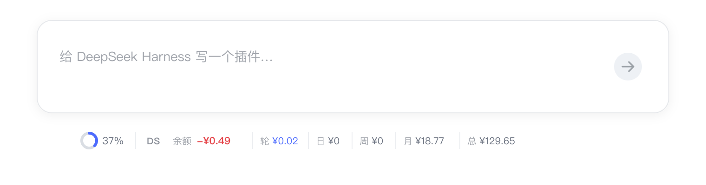
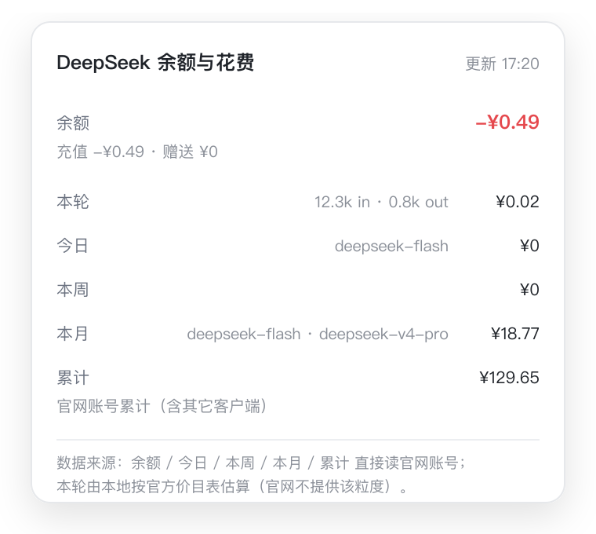

# dsh-deepseek-cost

在 **DeepSeek Harness** 的对话输入框下方，常驻显示 **DeepSeek 账号余额** 与
**本轮 / 今日 / 本周 / 本月 / 累计** 花费，悬浮看明细，点击立即刷新。

显示区域与样式沿用 [`dsh-go-quota`](https://github.com/skyrocks/dsh-go-quota) 的
输入框下方 dock（同一 `conversation.composer.dock` 槽位、同一套主题变量）。

<p align="center">
  
</p>

<p align="center">
  
</p>

> 以上为界面示意图，实际样式跟随 DSH 主题（明 / 暗）。

```text
DS  -¥0.49 │ 轮 ¥0.02 │ 日 ¥0 │ 周 ¥0 │ 月 ¥18.77 │ 总 ¥129.65
```

悬浮：

```text
┌ DeepSeek 余额与花费            更新 17:20 ┐
│ 余额      -¥0.49                        │
│   充值 -¥0.49 · 赠送 ¥0                 │
│ 本轮      ¥0.02    12.3k in · 0.8k out  │
│ 今日      ¥0        deepseek-flash      │
│ 本周      ¥0                            │
│ 本月      ¥18.77    deepseek-flash · …  │
│ 累计      ¥129.65   官网账号累计         │
└──────────────────────────────────────────┘
```

> **只在官方模型下显示。** 当前会话的 provider 是 `deepseek-official` /
> `deepseek-account` 时才出现；用 `opencode-go`、自建中转等订阅渠道时整条隐藏。

---

## 数据从哪来

| 显示项 | 来源 |
| --- | --- |
| 余额 | **官网账号** `GET /api/v0/users/get_user_summary`（充值 + 赠送钱包，透支显示为负数） |
| 累计 | 同一个接口的 `total_costs`：**官网账号累计消费**，含其它客户端与更早历史 |
| 今日 / 本周 / 本月 | **官网账号** `GET /api/v0/usage/by_api_key/cost`，按天时间桶求和 |
| 本轮 | **本地估算**：当前会话最新一轮的 assistant usage × 官方价目表（官网没有这个粒度） |

- 今日 / 本周 / 本月 按本机时区切天，周一为一周起点；金额与官网「用量」页一致。
- 本轮是唯一算出来的值，也是唯一不与官网一一对应的值。
- 未登录官网账号时：余额回退到 DSH 配置的 API Key → `/user/balance`，
  日/周/月/累计显示 `—`（官网数据需要登录态）。

## 官方价目表（人民币 / 每百万 tokens）

仅用于**本轮**估算：

| 模型 | 缓存命中 | 缓存未命中 | 输出 |
| --- | --- | --- | --- |
| `deepseek-flash`（含旧名 `deepseek-v4-flash*`） | 高峰 0.04 / 空闲 0.02 | 高峰 2 / 空闲 1 | 高峰 8 / 空闲 4 |
| `deepseek-v4-pro` | 高峰 0.30 / 空闲 0.15 | 高峰 9 / 空闲 4.5 | 高峰 27 / 空闲 13.5 |

高峰＝北京时间周一至周五 9:00–12:00、14:00–18:00（法定节假日无法本地判断，按高峰算）。

## 安装

### 桌面端（推荐）

1. 设置 →「插件」→「添加插件」，粘贴本地目录绝对路径：
   ```
   /Users/you/dsh-deepseek-cost
   ```
2. 完全退出 DSH 再打开（Host 插件只在启动时加载）。
3. 选一个官方 DeepSeek 模型，输入框下方出现 `DS 余额 … ｜ 轮 … ｜ 日 …`。

### 本地开发（link 方式）

在 profile 的 `package.json` 里加依赖与 bundle，然后重启：

```jsonc
{
  "dsh": { "profile": { "bundles": ["@deepseek-ai/dsh-base", "@deepseek-ai/dsh-web-app", "dsh-deepseek-cost"] } },
  "dependencies": { "dsh-deepseek-cost": "link:/Users/you/dsh-deepseek-cost" }
}
```

并让 `node_modules/dsh-deepseek-cost` 指向该目录（`pnpm install` 或手工软链）。
插件行由 `cordis.patch.yml` 自动插入，id 为 `deepseek-cost`。

## 配置

在 profile 的 `cordis.patch.yml` 里按 id 覆盖：

```yaml
- id: deepseek-cost
  config:
    cacheMs: 60000
    prices:
      deepseek-flash: { input: 2, cacheRead: 0.04, output: 8 }
```

| 字段 | 默认 | 说明 |
| --- | --- | --- |
| `refreshMs` | `30000` | 客户端轮询间隔（毫秒） |
| `cacheMs` | `60000` | 官网数据缓存（毫秒）；每次刷新最多 4 个请求 |
| `prices` | 官方人民币价目表 | **只影响本轮估算**：每 100 万 tokens，支持 `{peak, offPeak}` 双档或单档 |
| `currency` | `CNY` | 官网数据不可用时的展示货币 |
| `cnyToUsd` | `0.139` | 展示货币为美元时的折算率（只影响本轮） |
| `timeoutMs` | `15000` | 单次 HTTP 超时 |
| `clientVersion` | `1.0.0` | 发给官网的 `x-client-version` |

## 常见问题

**为什么没显示？**
当前会话的模型不是官方路由（`deepseek-official` / `deepseek-account`）时不会显示。

**余额、累计和官网一致吗？**
一致，直接读官网同源接口，不做二次计算。累计是账号维度，包含其它客户端的历史。

**「本轮」为什么和别的不一样？**
官网没有按轮次的数据，这一项只能是本地按官方价目表估算，会随每一步落账更新。

**日/周/月显示 `—`？**
官网数据需要登录态：设置 →「账户」里登录 DeepSeek 账号即可；未登录时只有 API Key 余额可用。

## 开发

```sh
node test/smoke.mjs     # 纯逻辑回归：价目表 / 高峰判定 / 分桶 / 官网响应解析 / codec
```

结构：

| 文件 | 作用 |
| --- | --- |
| `index.js` | Host 服务：官网数据读取与缓存、本轮折叠 |
| `official.js` | 官网接口：`get_user_summary` / `usage_by_api_key_cost` 的请求与解析 |
| `ledger.js` | 纯函数：事件 → 账本记录、按轮次分桶 |
| `pricing.js` | 纯函数：官方价目表、高峰判定、四桶计价 |
| `balance.js` | 纯函数：API Key 余额解析、凭据引用收集 |
| `client.js` | 客户端 dock、悬浮明细、官方路由门控 |
| `typert.host.js` | `deepseekCost/read`、`deepseekCost/refresh` 的 wire 清单 |

## License

MIT
